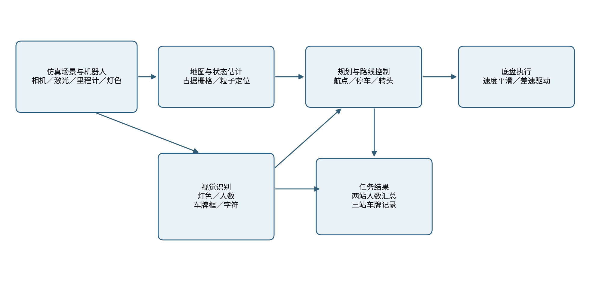
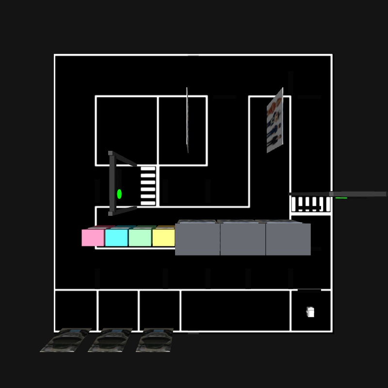
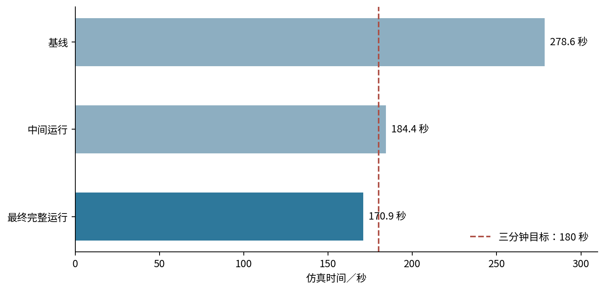
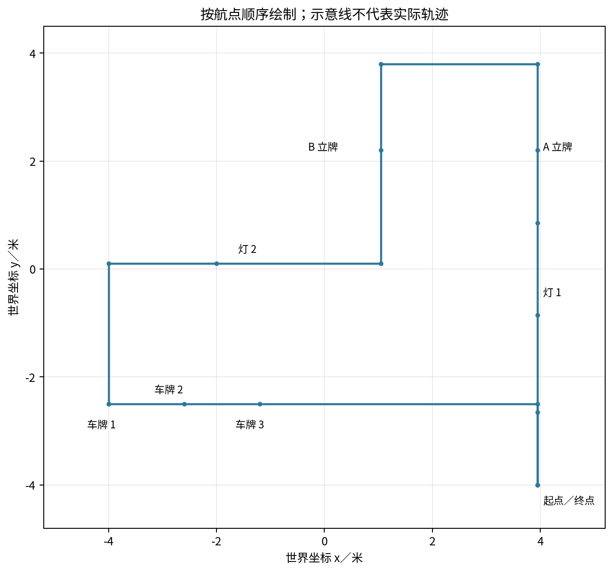

# 1. 引言

## 1.1 赛题理解与背景分析

智慧社区场景同时包含道路、楼宇、停车位、信号灯、立式人偶展板和车辆。机器人需要在同一趟运行中完成通行判断、路径行驶、指定地点观察和结果汇总。各任务之间存在先后约束：灯前必须先判断通行状态，立牌前必须停稳并朝向目标，车牌前必须连续检测到目标后再读取字符，所有观察点结束后还要返回起点。因此，评价对象不仅是单张图像的识别结果，还包括从场景启动到终点停车的完整执行链。

本项目的实现场景为约十米见方的社区道路模型，地面贴图带有连续白线、起点方框和车位边界。场景放置两组红绿灯、两块人偶立牌、三辆带车牌纹理的汽车、楼宇和四分类垃圾桶。小车从东南角出发，先向北穿过第一组灯，先后观察两块立牌；随后向西穿过第二组灯，在南侧停车带依次观察三辆车，最后沿东侧返回。目标是用一次启动串联全部模块，避免只展示独立的检测脚本而遗漏停车、转向、超时和保存环节。

技术报告以当前工作空间的源码、场景模型、测试脚本和完整运行日志为依据。项目包含两份可运行的检测权重，但未发现与它们对应的原始标注训练集、训练配置和独立验证集。因此报告记录的是该系统在现有仿真场景中的端到端结果，不把这些结果表述为模型在道路公开数据集上的准确率，也不声称已在实车道路测试。模板中的队伍名称、参赛编号和队员资料不在项目内，封面相应位置留待填写。

## 1.2 核心挑战与解决思路

第一个挑战是地图与可见道路不完全等价。地面白线只存在于纹理中，激光扫描不能把白线当障碍；信号灯横梁在小车上方，也不应被错误填入车体所在高度的二维地图。项目一方面从场景碰撞体生成与世界坐标对齐的占据地图，只把与雷达扫描高度相交的盒体写成障碍；另一方面从地面贴图提取白线，并在绕障候选轨迹上检查车体与白线之间的距离。两个表示分别处理实体碰撞和赛事要求的视觉边界。

第二个挑战是多源感知存在时延。相机为每秒八帧，深度模型在中央处理器上推理，单帧图像可能在回调处理前已被新帧替换。系统让摄像头订阅只保留最新图像，车牌检测放入后台线程，显示窗口按新图像刷新；人数模型只在立牌停靠时收到请求才推理。这样把持续导航与耗时推理解耦，但也意味着车牌、立牌的投票过程必须设置观察时间、最少票数和超时状态。

第三个挑战是定位与任务状态的持续性。仿真日志显示自适应粒子定位在起步后曾停止更新。如果路线只等定位消息，车辆会长期停住。系统在有定位时建立地图坐标和里程计坐标的锚点；定位暂时失联时，用连续里程计估算地图中的位置；两个位姿来源都超过两秒没有更新时停车。信号灯还同时提供图像判断和场景状态；任一来源报告红或黄时停车，图像看不到灯盘时由状态话题补充。该补充是当前仿真方案的一部分，不代表纯视觉灯色识别已经覆盖全部路口。

第四个挑战是总运行时间与观察质量相互牵制。若仅提高巡航速度，小车在窄通道前可能偏离中心并反复避障；若过早离开观察点，可能把偶发的人数或车牌字符误认为最终结果。项目把速度限制、目标朝向、停车观察和结果汇总分别放在路线状态机中。最终选用每秒零点三八米的默认巡航速度，转向时独立给出角速度上限，并保留红灯停车及每处车牌至少三秒的观察时间。完整测试的一圈仿真时间为一百七十点九秒；该数字仅对应报告中的测试条件。

# 2. 系统总体设计

## 2.1 设计目标

系统首先要完成一条闭环路线，按固定顺序到达十六个航点，避免为缩短路程跨越地面白线或略过观察站点。其次，遇到红灯和黄灯时车辆不能进入路口；前方障碍距离不足时应减速或停车，可绕行时只能在允许的车道区域寻找侧向通路。第三，两块立牌分别输出人数，最终还要给出 A、B 和总人数；三处车牌分别保存检测站点、读取文字、确认状态和票数。第四，系统必须在图像短时丢失、定位短时不更新及文字未识别时给出可解释的状态，而不是把空值写成成功。第五，完整仿真路线在保留上述停靠和等待动作的条件下，目标时间低于三分钟。

这些目标对应两类数据边界。场景设计值包括人偶立牌 A 的四个人、B 的五个人，以及三辆车共用的一张车牌纹理；它们用于核对仿真输出，不能在推理程序里写成识别结果。运行观测值则来自相机、雷达、里程计和系统日志。人偶人数由相机图像里的检测框逐帧统计，车牌字符由检测框裁剪后的文字识别生成。即使当前场景固定，结果也可能随视角和照明变化；报告把场景真值和实际输出分开列出。

## 2.2 系统架构图与技术路线

软件分为场景与传感器层、状态估计与路径层、视觉任务层、路线协调与结果层。场景层输出仿真时钟、激光扫描、彩色图像、里程计以及两组灯的场景状态。状态估计层加载二维占据地图，通过粒子定位获取地图位姿；路径规划器逐段检查能否到达目标。视觉层共享彩色相机，但灯色、人数和车牌各用不同的观察条件及处理频率。路线协调节点根据当前航点决定何时行驶、停靠、转头、发起人数请求、接收车牌检测、等待文字票数和写入结果。



图中实线代表当前代码中的消息或动作关系。相机原始图像分发给灯色、人偶计数、车牌检测和车牌字符识别四个节点。激光与里程计同时进入路线控制和定位模块；路线控制向速度平滑器发送速度命令，平滑器再输出给差速驱动。两组信号灯状态以话题发送，路线控制合并场景状态和相机判断。完成第二块立牌后一次性发布人数总结果；每块车牌分别追加一条记录。模块之间使用消息而非共享模型推理线程，以便区分回调堵塞、检测失败和路线等待。

路线按空间位置划分为四段。第一段沿东侧向北通过第一组灯，到 A 立牌前朝西停靠；第二段经北端向西再向南，在 B 立牌前朝西停靠；第三段经第二组灯转至西侧停车带，沿车位前的北侧通道逐车观察；第四段横穿至东侧并向南返回起点。路径文件给出十六个航点的平面坐标和目标朝向，累计相邻航点的直线距离约三十一点五米。真实行驶距离会因转头、避障和到点误差与该几何长度不同，因此不能用长度直接除以巡航速度代替实测圈时。

## 2.3 软硬件选型与配置

当前验证平台是虚拟机中的二维差速机器人。车体长零点三米、宽零点二米，左右轮半径零点零三五米、轮距零点二二米，前后有支撑轮。差速驱动插件接收平面速度命令，每秒五十次更新，并发布车轮里程计。雷达安装在车体前上方，扫描平面约离地零点一二米；其水平方向三百六十个采样点，十赫兹更新，量程上限十二米，仿真高斯测距噪声标准差为零点零零八米。前向单目相机输出九百六十乘七百二十像素彩色图像，视场角一点六弧度，每秒八帧，相机安装时向上俯仰约零点四弧度，使停车线前的高处灯盘进入画面。



软件环境使用 Ubuntu 22.04、Python 3.10、ROS 2 Humble、Gazebo Classic 11.10.2、Nav2、OpenCV 4.8.1、PyTorch 2.2.2 的中央处理器构建以及 RapidOCR 3.9.2。视觉依赖中 NumPy 为 1.26.4，避免旧模型权重与较新数组接口的兼容问题。定位导航采用地图服务、粒子定位、全局路径规划器和速度平滑器的轻量组合；完整的控制器、行为树和可视化工具只在需要时启动。测试虚拟机当次可见四个逻辑处理器与约五点六吉字节内存；报告不把这组虚拟资源等同于未来实车主控性能。

实车选型应以既有接口反推：主控需要同时接入每秒八帧的相机、十赫兹二维激光和左右轮编码器，并持续运行地图定位、路径查询和两套神经网络推理；底盘须满足约零点四二米每秒的线速度上限、约一点三弧度每秒的角速度平滑上限，以及停车时可靠制动。候选硬件需要通过现场功耗、时延、驱动支持和急停测试再确定。当前仓库没有具体实车板卡、相机型号、雷达型号或电池记录，因此这里只列选型指标，不虚构已购器件或实车续航。

# 3. 核心技术与模块实现

## 3.1 仿真平台搭建

场景文件描述地面、围墙、道路、三辆汽车、两块立牌、两组信号灯、三栋楼宇和四分类垃圾桶。地面黑白贴图提供车道边界，白线是视觉约束，楼宇、车辆、立柱和围墙有碰撞体。场景的物理步长为零点零零二秒，目标物理更新频率为每秒五百次。信号灯插件读取仿真时钟，按红十秒、绿十五秒、黄三秒的周期切换灯盘材质并发布状态；两组灯在当前实现中使用同一周期。灯盘的外观和话题都随插件变化，方便同时检验相机判断和路线停车动作。

地图生成工具遍历场景中的模型引用、模型、链接和盒形碰撞体，对每个碰撞体叠加位置与航向变换，只把与雷达高度零点一二米相交的截面栅格化。由此得到二百零八乘二百零八单元、每格零点零五米的二维占据地图，地图原点设在负五点二米、负五点二米。横跨道路上方的灯架横梁因不与雷达平面相交而不会挡住全局路径，立柱和车体则进入地图。栅格图供地图服务、粒子定位和规划器使用；道路白线另由地面图像处理，避免把纯视觉线条混同为实体障碍。

项目还保留了 Cartographer 的建图启动方式和地图截图，用于核对场景轮廓。不过当前闭环路线的导航默认载入按碰撞体生成的地图，而不是运行过程中在线建图。原因是现场地图需要与当前场景模型坐标保持一致；旧的在线建图结果曾与更新后的碰撞体布置不一致。报告中的“建图”因此区分两件事：一是保留的雷达建图能力，二是本轮路线实际使用的静态占据地图。不能把两者同时描述成正在给同一次路线实时供图。

## 3.2 软件核心框架与开发环境

工作空间拆成社区场景包和小车功能包。场景包保存世界文件、实体模型与周期信号灯插件；功能包保存机器人描述、导航配置、地图、启动文件和视觉、路线节点。启动入口先启动仿真和机器人，再延迟约十秒加载地图服务、定位与规划器，最后启动路线节点及识别节点。视觉进程在启动时加载模型，模型加载完成后才提供检测结果。该阶段若地图服务生命周期未激活，车会停在起点等待；日志里曾出现一次地图服务切换超时，这次实验未被当作有效圈时样本。

通信采用按任务划分的话题：图像、扫描和里程计是连续流；人数使用请求与返回两条话题；车牌检测框和字符识别结果分别发布；最终人数使用可迟到订阅的持久话题发布。人偶、车牌检测和读字节点的图像订阅使用深度一、尽力传输的消息队列，灯色节点队列深度为二；处理慢时跳过旧画面而看较新的画面。导航速度命令先写到独立话题，再由每秒二十次更新的速度平滑器输出到底盘。两类输出文件均放在日志目录，每轮测试使用独立目录，以免旧结果混入新的一圈。消息传输与规划、定位的配置依据可参见官方文档 [1]—[4]。

软件版本不是模型来源的证明。仓库中的人像权重含八十个类别，程序只请求编号为零的“人”；车牌权重只含一个“车牌”类别。人像权重文件约六点三兆字节，车牌权重约六兆字节。源码没有记录两份权重的采集地点、标注数量、训练轮次和训练集划分，因此不能给出本项目自行训练的平均检测精度。本报告中的性能数据来自仿真完整路线、五项图像处理单元测试及实际输出文件；若后续新建训练集，应先固化原始图像、标注与拆分规则，再训练和计算独立测试指标。

## 3.3 关键模块一：闭环路线、信号灯和安全控制

### 3.3.1 功能描述

路线协调节点将一次巡检表示为有序航点列表。每个航点包含名称、二维坐标和车头目标朝向；到达停车观察点时，只有位置和朝向都满足条件，才允许视觉任务接管。航点列表包含从起点出发、经过两个路口、在两块立牌前停靠、依次观察三辆车并回到起点的完整动作。车牌站位选在三辆车牌前方，使车头面向南侧；立牌站位使镜头正对人偶而非从侧面取景。路线状态索引只在到达并完成该航点动作后增加，因此不能因检测到远处的下一个目标就提前跳站。

每个路口都有等待区和通过区。小车接近等待区时检查对应信号灯，非绿灯先将车速限制到零点零八米每秒；进入闸线后，当前灯色若不是绿灯则发送零速度。视觉灯色和场景插件状态分别带有有效期，路线控制把任一来源的新鲜红灯或黄灯视为停车信号；只要存在新鲜绿灯且没有红黄信号，就允许通行；两路都无法判断时停车。这种合并方式使灯色不明时不会直接穿过路口，但依赖场景真值话题，是现阶段仿真辅助接口。实车不能连接该话题，必须验证纯相机判断在两个路口、不同照明和遮挡条件下的表现。

### 3.3.2 算法原理与实现方法

每段移动先向路径规划服务器请求当前位置到目标航点的路径。规划器使用静态占据地图和雷达障碍层；请求返回后，路线节点逐点计算路径到预设航段中心线的距离，任一点超过零点三五米时不执行该路径并等待重新规划。正常行进时，控制器在航段前方约零点三五米处选取追踪点，计算目标方位与车头朝向之差。误差较大时先原地转向；误差较小时，线速度在最低零点零六米每秒和设定巡航上限之间按目标距离调节，再按朝向误差折减。角速度由朝向误差按比例生成，并限制在正负一点一弧度每秒。接近目标前零点四五米时直接瞄准航点，减少因前视点越过目标造成的绕圈。

到点采用两个阶段：先检查平面距离小于零点二米，再停车原地调整车头，使绝对航向误差小于零点二二弧度。接手观察站点后，同一站点设置“已经正对”状态。若检测期间车头轻微漂移，只要航向误差仍在零点四弧度以内，就保持观察并继续处理结果；超过该范围才重置观察状态并再次对准。这个滞回区间避免此前在阈值附近一边观察一边重复转头的问题。转头过程保持线速度为零；完成车牌或立牌任务后清空当前路径，进入下一段规划，不把上个站点的追踪点带到下一段。

雷达安全门独立于路径规划器。前方近距离扫描小于零点三二米时，路线节点本轮只发零速度；扫描数据超过一秒未更新时同样停车。若前方静态地图之外存在障碍，控制器先计算左右候选绕行点，检查与白线的距离及前方碰撞状况。白线距离由场地图像二值化和距离变换预先生成，候选轨迹必须离白线至少零点二一米；没有可用侧向轨迹时等待，而不越线硬绕。规划请求因障碍或离开车道中心被拒绝时，车停下并在两秒后重试。这个机制既解释了短时等待，也使日志中能区分“仍在规划”“障碍等待”和“视觉等待”。

位姿优先使用地图定位结果。若粒子定位暂时不更新，程序用最近的地图位姿和里程计位姿建立一个局部变换锚点，将新的里程计位移映射到地图坐标后继续行驶；当地图定位恢复再更新锚点。若两路位姿均超过两秒未更新，立即停车。里程计积分在长时间行驶时会积累误差，因此该回退只适合短时维持路线，不能替代实车上的地图重定位。优化后的完整测试结束时，日志记录的里程计位置约为（3.865，−3.81）米，与起点（3.95，−4.00）米的平面差约零点二一米；这只是该次回圈的一个观测值，不是全路线定位精度。

### 3.3.3 遇到的难点与对策

第一个难点是灯牌、白线和建筑物对“可行驶区域”的含义不同。灯架上横梁能被相机看见却不阻挡车体，白线需要约束路径但没有碰撞体，建筑物和汽车必须作为实体障碍。因此地图生成按雷达高度切取碰撞体，白线另外作为侧向绕行约束，信号灯通过专门状态机决定停车。这三个判断共享车辆位姿，却不能互相替代。第二个难点是停靠点的朝向抖动：原有单一角度阈值可能使车头在目标附近重复修正。本轮代码通过到点停驶、观察状态保留和较宽的维持阈值减少重复转向。第三个难点是启动阶段的生命周期依赖；场景、地图服务、定位和规划器须依次就绪，完整测试只统计成功启动并到达终点的运行。

## 3.4 关键模块二：两块人偶立牌的计数与最终汇总

### 3.4.1 功能描述

人偶识别的输出有明确的时间顺序。小车先在 A 立牌前停车对准，向计数节点发出 A 请求，接收一个或多个带站点编号的计数结果；A 形成当前站点结果后，日志立即记录“A 立牌人数”，但此时不发布两块立牌的最终合计。车辆继续前往 B，仍需停车、对准、请求、投票。只有 B 完成后，路线节点把 A 和 B 的记录写入同一条结果表，再发布一次包含 A、B 与总人数的最终消息，随后继续车牌路线。若写盘失败，流程停在 B 并重试，避免“已输出最终值”却没有对应保存记录。

这里的“一边识别一边输出”和“全部识别后一起输出”分别指不同层次：每块立牌一经确认会有站点日志，便于观察当前进度；对外的总结果则在两块均处理完之后一次性发布。不能把 A 的即时日志说成巡检最终结果，也不能说所有人数到 B 才第一次产生。最终消息采用迟到订阅者仍能读取的发布配置，使显示界面晚于巡检节点启动也可收到当轮结果。

### 3.4.2 算法原理与实现方法

小车进入站点的正对状态后，路线节点按仿真时间每零点八秒发送一次对应立牌名称。计数节点平时只保存最近一帧相机图像；收到请求后先检查图像是否为一秒内的新帧，并限制两次推理之间至少间隔约零点七秒。若画面过旧，不使用前一站的缓存帧生成新结果。新帧先送入统一光照处理函数，再由人像检测模型推理。程序只取“人”这一类，置信度阈值设为零点一五，输入尺度设为一千二百八十像素。模型输出的人框还要通过站点几何条件：框中心落在画面横向百分之五到百分之九十五范围内，高度超过画面高度四分之一，框顶在高度百分之六十之上，框底到达高度百分之六十五之下。其目的在于排除远处小人、边缘截断图案和不占立牌主体的人形装饰。

一次通过几何筛选的检测框数就是该帧计数值，计数节点将“站点编号、人数”一起返回。路线节点只收当前站点编号的结果，并只接受一到二十的整数，防止上一块立牌的迟到消息混入下一块。当前站点的所有样本由计数器累积；出现同一个人数两次即记为 confirmed。若等待二十秒仍达不到两次，但至少取得一个有效人数，则标记 unverified 并保存当前最高票；完全没有有效返回则标记 unreadable，人数留空。超时、成功和未读出都允许路线继续，这避免识别服务失效时小车永远停在第二块立牌。终表字段包含两站人数、总人数、各自状态和各自票数；只有两站都达到 confirmed，才计算并公布数值总和，否则总人数写为未确认。

人偶立牌 A 和 B 在场景设计中分别画有四人和五人。三次完整路线的 A 均输出四人，B 分别输出三人、六人、五人，最终汇总分别为七人、十人、九人。由此可见“两票一致”是减少单帧波动的机制，不保证计数必然等于场景人数；同一种偏差如果连续两帧出现，也会被确认。当前系统把票数和状态一起保存，便于评审追查一次错误的来源，而不是只显示一个无法核验的总数。对实车或换场景使用，应增加不同距离、姿态和照明的样本，再考虑更长的时间窗或目标跟踪。

### 3.4.3 遇到的难点与对策

立牌上的人像是平面印刷画面，检测器学习的通常是真实人体外观，因此远距离、斜视和局部遮挡都可能改变框数量。路线通过站位和朝向先改善取景，再用框位置与高度剔除明显无关的人形；亮度异常时用图像预处理保持立牌主体可见。另一个难点是 CPU 推理耗时与 ROS 回调交错：若每帧都推理，路线需要的计数结果可能被排在大量旧画面之后。请求触发、最新帧缓存及推理节流将计算集中在停靠时。第二次识别曾出现车辆持续等待；当前二十秒超时与失败状态让该站有明确出口，但这意味着最终消息可能包含未确认人数，展示界面应把状态与数值同时显示。

## 3.5 关键模块三：三处车牌检测、字符识别与保存

### 3.5.1 功能描述

车牌流程针对三处固定站点依次执行，每处均遵循“驶近—停车转正—连续检测—留驻读字—写入记录—驶向下一处”的顺序。检测到车牌矩形框本身不足以结束一个站点，文字识别另由字符节点完成；两者分别有确认条件和状态。路线节点只允许当前位置属于三个车牌站点之一、车身接近该站坐标且朝向满足限制时接收检测框，避免经过车道时把旁边车辆车牌提前算作下一站。三处车牌都完成后才开始返航，终点以最终航点到达判定结束。

三个场景车辆使用相同车牌纹理，当前成功日志中的三个文字均为“浙C08X8B”。同一文字重复三次属于场景素材设置，不代表识别节点把第一辆车的结果复制给后两辆；每一站都有独立的检测确认、文字投票、写盘行。反过来，三个相同识别结果也不能证明模型已能区分真实社区中不同号码，需用不同纹理与独立测试图像进一步验证。

### 3.5.2 算法原理与实现方法

车牌检测节点订阅相机图像，始终保存最新帧供后台推理线程读取。后台两次推理至少间隔零点三秒，避免中央处理器上的检测推理阻塞画面窗口。每轮对输入帧做光照检查和必要的增强后运行单类车牌检测模型，保留置信度至少零点三的框。候选框按与画面中心的水平距离选择，且中心偏移不能超过画面宽度的四分之一。该选择契合“车头正对当前车辆”的站位设计；若两辆车牌同时挤进中心区域，仍可能选错，需要在扩展场地时加入站点对应的空间投影或目标跟踪。

窗口使用每零点零四秒一次的定时刷新，显示相机画面和最新检测矩形。定时器每秒约二十五次刷新界面，并不等同于相机每秒二十五帧：相机配置仍为每秒八帧，且推理可能慢于采集。窗口与推理分开后，画面不必等待每次模型推理才显示，因此主观卡顿减轻；报告不把窗口刷新频率当作实测有效识别帧率。检测节点发布五个数值：矩形左上角、右下角像素坐标和置信度。路线节点还检查框宽高比在一点五至七之间、当前位置和朝向，并要求连续收到三个合格结果，才宣布该站车牌“检测确认”。

文字节点获取当前图像和对应检测框后，在框左右各加约百分之五、上下各加约百分之十的边界，尽量保留汉字省份简称、末位字符和牌框边缘。裁剪图宽度不足二百四十像素时按比例放大，放大倍数上限为八，使用三次插值。然后分别尝试原始放大图与光照修正图；需要时另尝试强制增强图。识别引擎给出文字和置信分数后，程序使用“省份汉字、英文字母、五到六位字母或数字”的格式规则筛选，并将分数低于零点七五的候选丢弃。通过筛选的候选由文字节点发布，路线节点只在本车牌已经进入停靠观察状态后计票。

检测确认后车保持静止至少三秒，等待字符识别结果。同一字符串累计两票即可记 confirmed 并保存；若三秒时仍不足两票，则最多等待到十秒。十秒后有一票记 unverified，零票记 unreadable。写入的逗号分隔记录包含时间、站点编号、站点坐标、识别文字、状态和票数；写盘成功才转向下一辆车。这样检测任务与读字任务的失败可以在结果文件里分辨，而不会出现“框已找到”就被误称为“车牌内容已识别”。

### 3.5.3 遇到的难点与对策

车牌面积小，远处看见汽车并不意味着字符已经有足够像素。正对站位、连续检测和停车放大共同减少斜视、尺度变化对读字的影响。车牌纹理受场景光照和材质影响，简单整体提亮可能洗掉黑色笔画；文字节点同时试原图和局部增强图，保留原始信息供识别引擎比较。速度也是约束：若不等文字投票就离开，后续识别消息可能被写到下一站。当前节点将检测状态绑定航点，写盘前保持停车，状态转移时清空上一站投票。在首次基线完整运行中，第一处车牌为 unreadable、后两处 confirmed；后两次有效运行三处均 confirmed。因此性能分析报告逐次状态，不把单次成功率包装为模型的通用识别率。近年的复杂场景车牌研究也讨论了光照、倾斜和遮挡问题 [10]—[12]；其模型与本项目代码不同。

## 3.6 光照适应与模块协同创新

四类视觉任务共用一套光照诊断，但保留各自的任务阈值。对尺寸足够大的图像，诊断取中部区域：高度方向从百分之四十到百分之七十五、宽度方向从百分之十到百分之九十，以减少天空和车体边缘对亮度统计的干扰；对较小的灯色区域或车牌裁剪图，则使用整个输入区域。该区域转换为灰度，计算四分位亮度。上四分位亮度低于六十时判断为暗光；下四分位亮度高于一百七十且上四分位达到二百二十时判断为过曝；四分位差低于三十五且上四分位不到一百八十五时判断为低对比。均不满足时直接返回原图，避免对正常场景重复增强。

异常图像转到亮度与色度分离的颜色空间，仅调整亮度通道。增益依当前上四分位亮度与目标亮度一百一十五之比计算，限制在零点六五到二点五之间；再应用带裁剪限制的局部直方图均衡，常用网格为八乘八，必要时四乘四。对暗光，增益提高暗部可见度；对强光，增益可降低亮部饱和趋势；局部均衡让字符和轮廓附近的明暗差更容易保留 [7]。处理后的图像不能恢复完全被曝光压平的纹理，亦可能放大传感器噪声，因此文字节点还保留原图候选，灯色节点用独立的色相和饱和度条件判断红、黄、绿。

Gazebo 启动参数提供正常、暗光和强光三种世界照明设置，改动的是环境光和太阳光源，而不是直接给识别结果加标签。这使相机、立牌、车牌和灯盘在仿真渲染中一起受到照明变化。当前自动化单元测试覆盖五组人工构造图像，包括暗光与强光的主体亮度变化以及红灯、绿灯颜色保留，五项均通过。这个测试能证明预处理函数在构造条件下按预期变化，不能替代三种照明下分别跑完整路线的识别率实验。所需的进一步验证是固定场景种子和路线起点，各光照至少多次完整运行，分别统计两个立牌、三个车牌和两个灯的正确率、总耗时与失败模式。

系统的工程特点不是单个网络结构，而是任务顺序和结果可信状态被写进路线控制。人偶计数的站点日志与最终汇总有清晰边界，车牌检测和字符识别有独立确认，视觉异常有时限和状态字段，地图、白线、信号灯分别承担不同约束。这样的组织方式使“识别失败后车为什么停住”与“某个结果为何写入文件”都能从状态、票数和日志回溯。

# 4. 仿真到实车迁移设计

## 4.1 迁移方案

当前成果是仿真闭环，不包含实车上路试验。迁移时先保持路线节点、视觉任务接口和结果文件格式不变，用实物传感器驱动替换仿真相机、激光与里程计输入。具体步骤应从坐标和时间一致性开始：检查相机光心、激光扫描平面和车体中心之间的固定变换，量出轮半径、轮距、相机俯仰与安装高度；在静止、直行和原地转向三种动作下校准里程计。只有这些量可复测，仿真中的航点半径和转头条件才有现实含义。实车主控应在发布速度后读取电机编码器确认执行，急停按钮与底盘供电切断应独立于视觉进程。

其次重建现场地图。按真实社区道路尺寸采集激光数据，标注固定围栏、灯杆和停车位，并实测白线位置。仿真中从世界模型直接切出碰撞地图的做法不能移到未知现场；现场可先进行激光建图，再核对地图与白线是否错位。最小通道宽度、车辆转弯半径和膨胀半径要以实车外轮廓重新计算。当前机器人车体宽零点二米，但导航配置采用零点二米的机器人半径，已为仿真绕障留出余量；实车若装有超出车壳的相机支架，半径仍须重测。白线距离阈值也需与实际车道线宽和轮廓宽度一起校准，不能直接复制零点二一米。

信号灯接口是迁移时最重要的替换点。仿真路线能够读取场景插件发布的灯色真值，实车没有对应来源，必须以相机灯色为主，再辅以车位前的停车线定位。现场首先采集白天、背光、夜间、雨后反光和车辆遮挡下的红黄绿灯图，标注可见区域和状态。单次颜色掩膜得出的绿灯不能直接许可通行；实车方案应要求连续若干新鲜观测一致，且在遮挡、视野外或订阅中断时保持停车。通过路口后再取消该组灯的阻停条件，避免车已越过停车线却因灯切换停在路口中央。需要有人工遥控接管与明确的场地安全员流程，才能开展封闭场地试验。

视觉模型也需要重新收集数据。仿真立牌上的人是印刷图案，真实场景可能有人走动、重叠、背对镜头，目标类别与仿真存在差别；车牌存在倾斜、遮挡、反光、脏污和不同省份字形。应按日期、位置、距离和照度采集原始图，先做去重与隐私处理，再按采集批次切分训练、验证、测试集，避免同一立牌或同一辆车的相邻帧横跨不同集合导致评估偏高。每张图至少标注车牌框、字符真值、人像框、灯色与是否可读；对于不可读图保留明确标签，不强迫模型输出虚构文字。训练后除总体指标外，还应按光照、距离和遮挡分层统计，并在设备上测延时。仿真到现实的外观差异已有近期机器人研究讨论 [9]，但该研究针对飞行机器人，本项目仅借鉴其问题划分。

最后迁移路线状态机。仿真时钟在物理世界由单调时钟替代；要分别定义图像有效期、请求超时、路口等待上限和停车保持时间。结果文件先写临时行再安全落盘，并为每一轮加运行编号，避免掉电后把半圈结果误当完成。首次实车运行应在封闭空地低速执行：先验证直线、转头与刹车，再逐个站点加入人偶、车牌和信号灯，最后才连成一圈。仿真中一次低于三分钟的结果不能推出实车也低于三分钟；现实延时由地面摩擦、行人让行、灯时序、模型硬件和安全限速共同决定。

## 4.2 环境干扰应对

光照干扰已经在仿真中形成可复现入口：启动时可切换三种照明，图像进入任务节点前可按四分位亮度决定是否处理。大尺寸相机帧取中部统计，小尺寸灯盘或车牌裁剪区取整个输入区；同一处理函数分别服务于人偶、车牌与灯色任务。现场需要进一步把曝光和白平衡锁定或记录在日志中，否则相机自动曝光不断变化会使同一照明条件下的阈值判断不稳定。对于车牌镜面反光，应改变观察距离或角度并保留多帧候选；完全饱和的区域靠软件对比度处理无法复原。对于暗光，优先考虑补光和保证快门时间，再调整图像；单纯放大暗部也会放大噪声。

动态障碍由激光扫描和地图差分处理。当前仿真把不在静态地图上的近处回波视为可能绕行对象，检查左右候选是否越线；没有合法通路就停车等待。现实场地中，行人和宠物运动方向会改变安全距离，仍需加入目标速度估计和安全员检查。地面反光、白线磨损和阴影可能使图像白线提取失效，因此实车不应只靠一张俯视贴图计算白线距离，而应结合实际相机视角、地图中的可行驶区和现场边界。定位方面，短时粒子定位丢失可以沿里程计锚点行驶，但累计误差和车轮打滑会扩大；连续丢失到超过阈值时必须停车，待重新定位后再规划。

通信与资源干扰同样需要分开处理。相机每秒八帧，窗口每秒可刷新约二十五次，检测线程最短间隔零点三秒，这三个速率对应采集、显示和推理，不能混作一个帧率。中央处理器负载上升时，队列深度一使识别舍弃旧图，站点检测可能延迟；日志应记录图像时间戳、推理开始与完成时间、发布结果时间和路线状态。视觉节点重启后，保留的结果不应跨轮复用。对未确认识别，系统通过状态字段说明证据不足，让巡检继续而不无限等待；但在真实安全决策中，灯色未知仍需停车，不能沿用“任务超时后通过”的逻辑。

# 5. 测试与成果分析

## 5.1 功能测试

本报告的实测材料来自三次成功返回起点的完整仿真运行，以及五项光照处理单元测试。三次运行分别保存在独立日志目录，包含启动记录、路线节点日志、按站点写入的车牌结果、一次汇总的人偶结果和监测数据。仿真圈时以巡检开始到路线节点报告完成为准；墙钟耗时按启动脚本记录的开始与结束时间取整，包含启动环节，用来区分两种计时口径。期间还有一次较高速的探索运行在第二块立牌前因前方障碍等待而中止、一次地图服务启动失败的尝试；它们不满足完整回圈条件，不参与完整圈时比较，但作为故障案例讨论。

| 运行编号与日期 | 仿真圈时 | 墙钟耗时 | A 立牌 | B 立牌 | 最终合计 | 三处车牌状态 |
| --- | ---: | ---: | ---: | ---: | ---: | --- |
| 10月8日23:13基线 | 278.6秒 | 314秒 | 4 | 3 | 7 | 未读出／确认／确认 |
| 10月9日00:15调整后 | 184.4秒 | 234秒 | 4 | 6 | 10 | 确认／确认／确认 |
| 10月9日00:20最终完整运行 | 170.9秒 | 209秒 | 4 | 5 | 9 | 确认／确认／确认 |



上述三次运行均完成了路线节点定义的十六个航点并返回起点。立牌 A 的设计真值为四人，三次均与之相同；B 的设计真值为五人，三次中只有最后一次相同。最终完整运行两站人数和总数均与场景设计值一致，三处车牌识别文字均为“浙C08X8B”，且三个站点都有 confirmed 状态及独立保存行。基线第一处车牌未读出，说明流程能写入失败状态并继续下一站；这也是不能只报告最后一次成功案例的原因。

信号灯的功能证据需要拆开看。第一组灯的视觉节点在基线监测中出现红、绿、黄三种状态；第二组灯的相机视觉记录一直是 unknown，但路线仍依据场景插件的新鲜状态停车或通行。最终完整运行日志中出现过第二组灯的停车等待记录，路线随后完成回圈。可据此判断当前仿真闭环没有无视第二组灯的场景状态，却不能据此声称第二组灯的视觉识别已经成功。在移除场景真值话题前，必须修正第二组灯的画面投影、观察角度或颜色阈值，并进行纯视觉路口测试。

光照测试方面，五项图像处理单元测试在当前环境均通过，耗时约零点一九秒。测试输入是人工构造的暗光、强光与交通灯颜色块，用来检查亮度分支和颜色保留；它们不是在世界场景中跑三种照明各一圈，也没有给出车牌或人偶的完整识别率。暗光场景中保存了立牌和灯盘画面，可用于人工观察图像是否进入任务节点；未来应将三种照明的完整路线与标注结果对应保存，才能比较各光照条件下的逐站识别差异。

## 5.2 性能测试

以三分钟即一百八十秒为目标，最终完整运行的仿真时间为一百七十点九秒，低于目标约九点一秒。相对最初二百七十八点六秒的基线，减少一百零七点七秒，约为基线的百分之三十八点七；中间一次一百八十四点四秒，说明仅靠部分调整仍略高于三分钟，最终一圈才满足目标。仿真时间和墙钟时间差距明显：最终运行从启动脚本开始到结束的墙钟耗时按整秒记录为二百零九秒，比仿真圈时多约三十八秒，其中包括启动环节。比赛若以仿真时钟计分，该次达标；若以从按下启动到系统退出的真实时间计分，则不能说已达到三分钟。两种口径必须提前与赛题评分规则核对。

速度设定为零点三八米每秒，但线路有红灯等待、车头对准、每块立牌投票、每块车牌至少三秒留驻、近障碍减速以及路径规划等待。十六个航点相邻直线长度约三十一点五米，用零点三八米每秒计算的理论纯直行时间约八十二点九秒，只是一个不含上述动作的下界。实际一百七十点九秒比它多约八十八秒；目前没有逐动作的统一时间戳标注，无法据此计算灯前等待、识别和转头各占用多少时间。建议后续在状态转换时记录仿真时间，形成每站移动、转向、等待和读字耗时表，再决定优化优先级。

一次把巡航速度提高到零点四四米每秒的探索没有完成闭环，在第二块立牌附近遇到障碍等待且人数有偏差。因此当前版本选择已完成验证的零点三八米每秒，而不是用未完成探索推断更快路线一定可行。更高速度会减少直线行驶时间，但也缩短相机正对目标的窗口，增加近障碍制动距离和到点转向次数。由于仅有三次完整运行、场景固定、虚拟机负载随启动进程变化，表中的时间不能当成稳定均值或置信区间；它们是有日志可追溯的个例。

识别性能只能报告逐站结果。对人数，六个站点观测中 A 有三次与设计值一致，B 有一次与设计值一致；合并来看，六次站点计数中四次与真值相同，三次完整圈只有一次总人数正确。这个“六选四”只描述同一场景的三次运行，不可解释为模型在未知立牌上的准确率。对车牌，九个站点记录中八个为 confirmed、一个 unreadable；因三个车位共用同一文字纹理，确认状态代表投票满足条件，不足以证明多种文字的泛化能力。对交通灯，第二组视觉状态未知较多，不能按场景插件通行记录计算视觉灯色正确率。

## 5.3 成果展示与可复核材料

成果展示应按执行时间串联：启动场景后展示小车与道路、两组灯切换；镜头跟随小车先到 A 立牌，屏幕出现当前站点计数日志；再到 B，等待最终人数消息及表格落盘；随后依次停在三辆车前，窗口显示绿色车牌框，控制台显示文字与确认状态；最后车辆回到起点，日志提示完成。展示时应同步显示仿真时钟，以免墙钟与圈时混淆。若现场需要演示失败处理，可用第一次基线的车牌未读出记录和第二组灯视觉 unknown 说明状态字段的作用，而不是删去不理想记录。



当前仓库中有场地截图、地图截图和完整运行日志，但没有找到可核对拍摄时间与内容的视频成品。因此报告将图示、日志与结果表作为现有成果，不声称已提交演示视频。正式提交时可按上一段脚本录屏，并将画面与同一次运行编号绑定；视频中的人数、车牌及终点画面应与该轮结果文件一致。对外展示之前还应隐藏与任务无关的系统桌面内容，并在标题页补齐队伍名称、参赛编号和成员信息。

## 5.4 答辩展示思路

答辩先用场地俯视图说明比赛任务及两灯、两块立牌、三辆车和起点的空间关系，再用系统数据流图解释图像、雷达与路线状态机之间的输入输出。演示过程中重点展示三个状态边界：立牌 A 先产生站点记录、B 后写汇总并发布最终人数；车牌框的连续确认与字符的两票确认是两个阶段；信号灯 unknown 时路线停车或使用仿真真值，不能说成视觉已经识别成功。随后给出三次完整圈时表和人员误差表，说明最终一圈低于三分钟，但模型在 B 立牌的重复运行结果仍不稳定。

评委如果询问模型训练，应展示仓库已有权重和现有数据边界：项目没有可追溯的原始训练集与标注文件，因此本报告不编造训练轮次、损失曲线或平均精度。可说明后续如何采集场景不同时间、距离和光照的图像并划分数据集，以及需要报告哪些独立测试指标。若询问实车迁移，应指出地图需要重建、相机与里程计必须标定、仿真灯色真值必须移除，还要补齐急停和低速封闭场地测试。这样的说明比只展示一次成功视频更能对应工程实现的边界。

# 6. 总结与展望

## 6.1 工作总结

项目完成了一个可运行的社区巡检闭环：差速机器人在 Gazebo 场景中按十六个航点行驶，利用地图、雷达和里程计保持路线；到路口根据灯色停行；到两块人偶立牌分别发起计数，在第二块完成后写入并发布 A、B 和总人数；到三辆车前分别完成车牌检测、文字读取和结果保存，最后回到起点。正常照明下最后一次完整运行的仿真圈时为一百七十点九秒，两块立牌分别记录四人与五人，三个车牌站点均保存确认文字。系统还提供暗光、强光场景入口和按亮度统计触发的图像预处理，五项构造图像单元测试通过。

这些成果有明确限制。完整路线只有三次有效样本，B 立牌在其中两次与设计人数不一致；第二组交通灯的视觉状态仍主要为 unknown，路线依赖仿真场景真值；三个车位使用同一车牌纹理，不能验证不同文字的泛化。报告没有把失败样本排除后再推导识别准确率，也没有把仿真圈时等同于实车耗时。当前证据支持“在指定仿真场景中完成一次低于三分钟的闭环，并保存相应任务结果”，尚不支持“在任意场景和光照下都稳定完成”的表述。

## 6.2 未来展望

短期首先修复第二组灯视觉判断，并在断开场景真值话题的条件下重复路口测试。其次对 B 立牌增加不同站距、朝向与光照样本，检查同一错误数值连续投票的原因，可试用跨帧目标关联、图像透视矫正或区域分割，但每一种改动都需通过独立测试数据比较。车牌应改为三辆车使用不同号码，并增加不同省份、字符颜色与遮挡素材，逐项统计检测框、字符内容和保存状态。性能方面，应把航点状态转换的仿真时间写入日志，以确定哪些停车和推理等待占用最多时间，再在保障停车距离的前提下调整路线速度。

中期建立可追溯数据集与模型版本记录，包含原始图像、标注、训练参数、验证集和独立测试集；让灯色、人偶、车牌分别形成按光照与距离分组的指标。长期进入实车封闭场地，按传感器标定、地图重建、急停、单站识别、单路口通行和完整闭环逐级验收。只有当实物平台的定位、交通灯判断和制动在多次测试中有记录可核，才适合讨论开放社区道路的应用。

# 附录

## 附录 A 测试数据与复核口径

三次完整运行对应的日志目录依次为 route_check_20261008_231324、route_check_20261009_001518 和 route_check_20261009_002015。每个目录中应对照 run_status、路线节点日志、person_results 表和 plate_results 表读取同一轮数据。仿真圈时按完成日志中的仿真时间计算；墙钟耗时直接取 run_status 中包含启动过程的整数秒记录。人物设计真值来自场景立牌素材，车牌设计文字来自车辆纹理；二者是核对依据，不来自路线节点硬编码。日志中出现的 repeated red 等同一停车状态的多次提醒不能按提醒条数计算路口次数。路线依靠场景灯色完成的通行，也不能拿来统计相机灯色识别率。

## 附录 B 关键流程伪代码

```text
到达 A 站并正对 → 周期请求 A 人数 → 收到两票相同或满二十秒 → 暂存 A 并写站点日志
到达 B 站并正对 → 周期请求 B 人数 → 收到两票相同或满二十秒 → 写一行 A/B/合计 → 发布最终消息
到达车牌站 n 并正对 → 连续三次合格检测框 → 停至少三秒 → 文字两票或满十秒
若结果文件写入成功 → 清除站点检测和文字票数 → 进入车牌站 n+1 或返航
任一时刻：近障碍、雷达失联、位姿全失联、路口非绿灯 → 发布零速度并保留当前任务
```

## 参考文献

[1] ROS 2 Documentation. ROS 2 Humble documentation: quality of service settings [EB/OL]. https://docs.ros.org/en/humble/Concepts/Intermediate/About-Quality-of-Service-Settings.html，访问日期：2026-10-09。

[2] Navigation2. Configuration Guide: AMCL [EB/OL]. https://docs.nav2.org/rolling/configuration_and_development/configuration_guide/others/configuring_amcl/，访问日期：2026-10-09。

[3] Navigation2. Configuration Guide: Planner Server [EB/OL]. https://docs.nav2.org/rolling/configuration_and_development/configuration_guide/core_servers/configuring_planner_server/，访问日期：2026-10-09。

[4] Navigation2. Configuration Guide: Velocity Smoother [EB/OL]. https://docs.nav2.org/rolling/configuration_and_development/configuration_guide/core_servers/configuring_velocity_smoother/，访问日期：2026-10-09。

[5] Gazebo. Migration from Gazebo Classic [EB/OL]. https://gazebosim.org/docs/latest/gazebo_classic_migration/，访问日期：2026-10-09。

[6] Ultralytics. YOLOv8 documentation [EB/OL]. https://docs.ultralytics.com/models/yolov8/，访问日期：2026-10-09。

[7] OpenCV. Histogram Equalization and CLAHE Tutorial [EB/OL]. https://docs.opencv.org/4.13.0/d5/daf/tutorial_py_histogram_equalization.html，访问日期：2026-10-09。

[8] RapidAI. RapidOCR Quick Start [EB/OL]. https://rapidai.github.io/RapidOCRDocs/main/quickstart/，访问日期：2026-10-09。

[9] Quach A, et al. Gaussian Splatting to Real World Flight Navigation Transfer with Liquid Networks [C]//Proceedings of the Conference on Robot Learning. PMLR, 2025. https://proceedings.mlr.press/v270/quach25a.html。

[10] License plate recognition system for complex scenarios based on improved YOLOv5s and LPRNet [J]. Scientific Reports, 2025. https://www.nature.com/articles/s41598-025-18311-4。

[11] Advanced deep learning techniques for automated license plate recognition [J]. Scientific Reports, 2025. https://www.nature.com/articles/s41598-025-24967-9。

[12] Bathirappan K, Soundararajan J. A channel and spatial attentions mechanisms with CNN for enhanced license plate detection [J]. Scientific Reports, 2026, 16:17874. https://www.nature.com/articles/s41598-026-46156-y。

文献 [9]—[12] 仅用于说明相关领域近期对跨环境迁移和复杂场景车牌读取的研究方向；本项目没有实现其论文中的网络结构，也不借用其论文结果作为本项目指标。文献 [1]—[8] 对应本项目使用或计划迁移的工具与方法。项目实测数值的来源均为附录 A 所述的本地日志与结果表。
